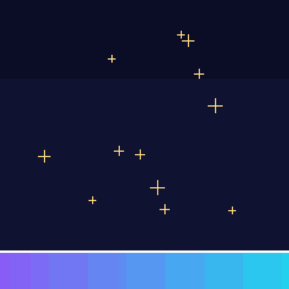
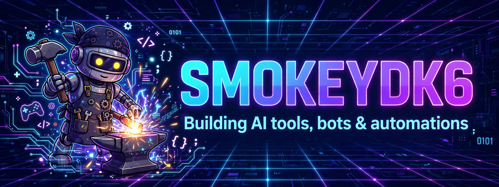
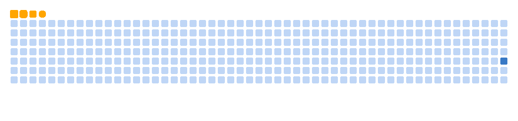

  

  

<h1 align="center">Hi there, I'm Søren 👋</h1>

  

  
  
  

## 🚀 About Me

- 🇩🇰 Builder from Denmark — I turn ideas into working things, fast
- 🤖 Built an **automatic bot system that answers customer inquiries** — saves me 3–5 hours a week and answers customers right away
- ⚒️ Creator of **Forge**, the Discord bot for **The AI Workshop** — XP & levels, AI news, tickets, weekly challenges, automod and more
- 👥 Founder of the **AI Creators Community** (Facebook) and **The AI Workshop** (Discord) — places for AI creators to share workflows, tips and tools
- 🎮 I also build games and small web tools, just for the fun of it

## 🛠️ Tech Stack

  
  
  
  
  
  
  
  
  

## 📌 Featured Project

🤖 **[forge-bot](https://github.com/Smokeydk6/forge-bot)** — Forge, the Discord bot for The AI Workshop: verify gate, XP &amp; levels, AI news, tickets, weekly challenges, automod. Built with Python and discord.py.

## 📊 Stats

  
  

  

## 🐍 My Contributions

  

---

💬 Come say hi in <a href="https://discord.gg/Szb3S9epuW">The AI Workshop on Discord</a> or in the <a href="https://www.facebook.com/groups/1813070176444737">AI Creators Community on Facebook</a> — no question is too basic. 🚀

